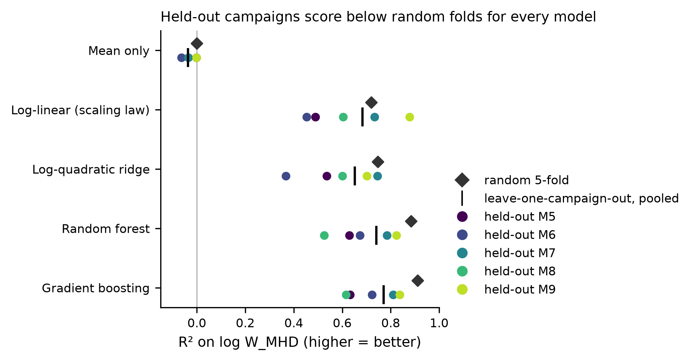
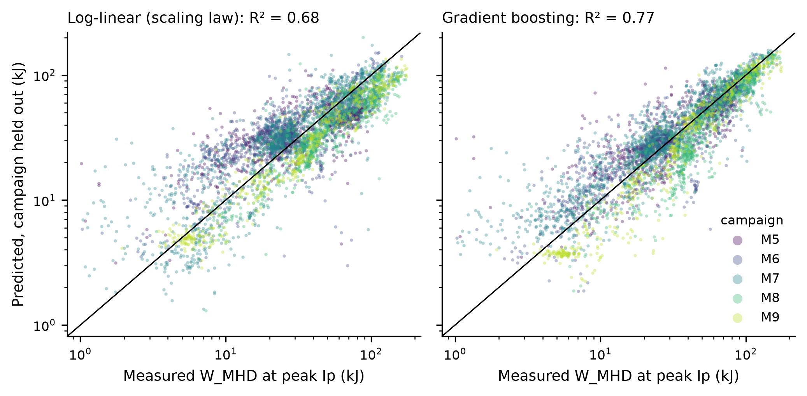
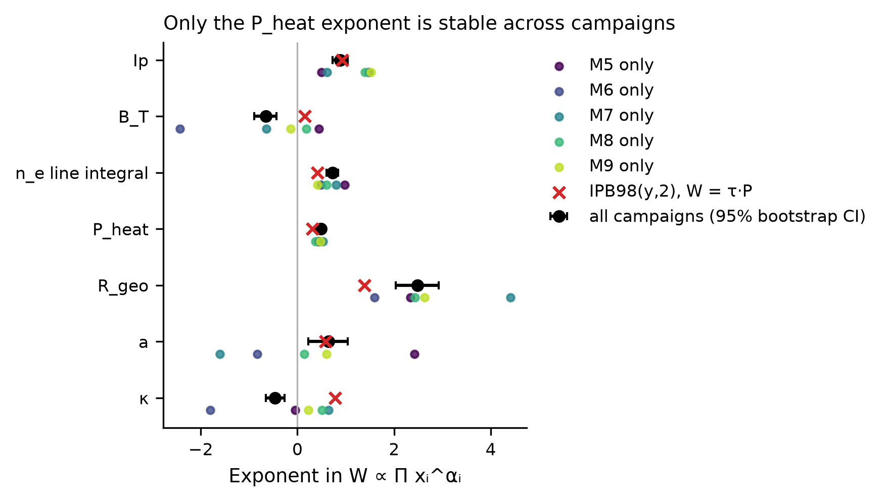

# DIII-D & MAST ML Exploration

Learning to apply machine learning to open fusion data from two tokamaks: DIII-D (General Atomics, USA) and MAST (UKAEA, UK).

The main question to start with: can a model reconstruct the plasma's magnetic flux map ψ(R,Z) from coil currents and Thomson scattering alone, without magnetic sensors? And does what it learns on DIII-D carry over to MAST?

Before getting to that, I'm getting to know the FAIR-MAST shot table and fitting a first regression baseline on it.

## Data

| Source | What it has |
|---|---|
| [Fusion Equilibrium Challenge dataset](https://huggingface.co/datasets/Sophelio/fusion-equilibrium-challenge) | 7,041 labeled DIII-D shots, 1,206 MAST shots (inputs only), cleaned and documented |
| [FAIR-MAST](https://github.com/ukaea/fair-mast) | 11,573 MAST shots with the full set of signals |

The challenge dataset (NeurIPS 2026) was released by Sophelio and General Atomics under CC BY 4.0. This repo is not a challenge entry. Its [starter kit](https://github.com/Sophelio/fusion-equilibrium-challenge-starter) and [modeling guide](https://github.com/Sophelio/fusion-equilibrium-challenge-starter/blob/main/MODELING_GUIDE.md) are where I start.

FAIR-MAST metadata moved: the `mastapp.site` API was shut down in October 2026. The shot, source and signal tables are now parquet files at `https://s3.echo.stfc.ac.uk/mast/fairmast-meta/` (`l2_shots.parquet` etc.).

## Files

- `eda.ipynb`: loads the shot table (cached to `fairmast/shots_level2.parquet`) and runs the column-classification checks, writing `classification_checks.csv`, `column_summary.csv` and `figures/classification_*.png`
- `column_classification.md`: what every shot-table column means, and its role (ignore, filter, feature, target, leakage)
- `baseline.py`: first regression baseline (scikit-learn). Run `python baseline.py` from the repo root; it writes `results/*.csv` and `figures/baseline_*.png`

## Findings so far

### The shot table

- 11,573 shots and 189 columns, all classified. 6,589 shots are flagged useful and not aborted.
- Most columns are CPF (MAST Central Physics File) summary values, renamed in FAIR-MAST. Some of the new names are misleading:
  - `generic_max_beta_mhd` and `generic_min_radius_max_plasma` hold the *time* at which the quantity peaks, not its value.
  - `generic_max_energy_time` is the confinement time τ_E itself.
- `nbi_power_max_current` collides two CPF fields, and the collision is resolved row by row. On SS-beam-only shots it equals the SS power (so it is the total). On two-beam shots it is about 44% of peak power, i.e. SW-beam power only. Total beam power has to be rebuilt as SS + SW: with that fix it stays at or below the shot's peak total on 85% of shots, versus 55% before.
- Units (nothing in the file says): Ip in kA, B_T in T, n_e in m⁻³ (line integral in m⁻²), T_e in eV, W in J, τ_E in s, powers in MW.
- B_T is negative on almost every shot and Ip on a few; the sign is the field or current direction, so I use |B_T| and |Ip|.
- τ_E is literally W / P on ohmic shots (median ratio 1.03), and β ∝ W/(V·B_T²) holds with R² = 1.000. So τ_E and β are **leakage** when predicting W and must not be used as inputs.

### First regression baseline (`baseline.py`)

- Target: log W_MHD at peak plasma current.
- Inputs at the same moment: |Ip|, |B_T|, line-integrated density, P_heat = P_ohm + P_NBI, R_geo, a, κ.
- 4,700 shots after cleaning (M5 678, M6 1,023, M7 1,551, M8 893, M9 555).
- Two validation schemes: random 5-fold, and leave-one-campaign-out (train on four campaigns, test on the fifth).

| Model | R², random 5-fold | R², campaign held out | Median error in W, campaign held out |
|---|---|---|---|
| Mean only | 0.00 | −0.04 | 56% |
| Log-linear (scaling law) | 0.72 | 0.68 | 31% |
| Log-quadratic ridge | 0.75 | 0.65 | 32% |
| Random forest | 0.88 | 0.74 | 25% |
| Gradient boosting | 0.91 | 0.77 | 22% |

- **Random folds overstate how well the models generalise.** Gradient boosting drops from R² 0.91 to 0.77 when a whole campaign is held out. Shots within a campaign are similar, so random splits partly test memory. Use campaign splits from now on.
- **A plain power law already explains about two-thirds of the variance.** Trees add about 0.1 in R² on unseen campaigns, and the quadratic ridge model adds nothing.
- **Hardest campaigns:** M5 and M6 for the power law (R² 0.49 and 0.45), M8 for the tree models (0.62 for gradient boosting, 0.53 for random forest).
- **Fitted power law (all campaigns):** W ∝ Ip^0.88 · B_T^−0.65 · n^0.73 · P^0.48 · R^2.5 · a^0.64 · κ^−0.46.
  - The Ip exponent matches IPB98(y,2) (0.93).
  - The P exponent of 0.48 means τ_E ∝ P^−0.52, a weaker power degradation than IPB98's P^−0.69.
- **Most exponents are not trustworthy yet.** Fitting each campaign separately:
  - P_heat is stable (0.37 to 0.53).
  - B_T swings from −2.4 to +0.4, Ip from 0.5 to 1.5, and R_geo from 1.6 to 4.4.
  - B_T barely varies in this data (about 8% spread, campaign medians 0.44 to 0.45 T) and moves with R (correlation −0.60), so its exponent can't be pinned down. The bootstrap CIs are much too narrow for that reason.
- Gradient boosting's permutation importance ranks B_T first. That is most likely B_T standing in for geometry and campaign, not a physical effect.

## Next

- Use flat-top averages from the per-shot `summary` traces instead of single "at peak Ip" values.
- Add the shot-configuration categoricals (heating, shape) where they are filled in.
- Try a dimensionless version of the scaling (in terms of ρ*, β, ν*), which may fix the unstable exponents.
- Then move on to the ψ(R,Z) reconstruction question.

## Credits

DIII-D and MAST data via Sophelio / General Atomics (CC BY 4.0) and FAIR-MAST / UKAEA. Starter kit code: MIT.
